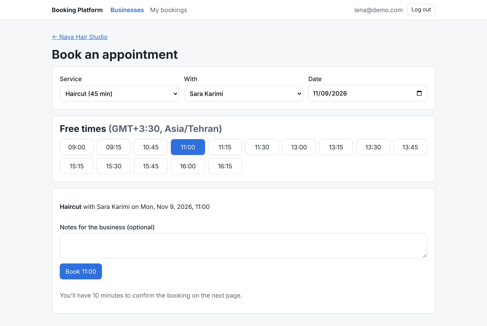
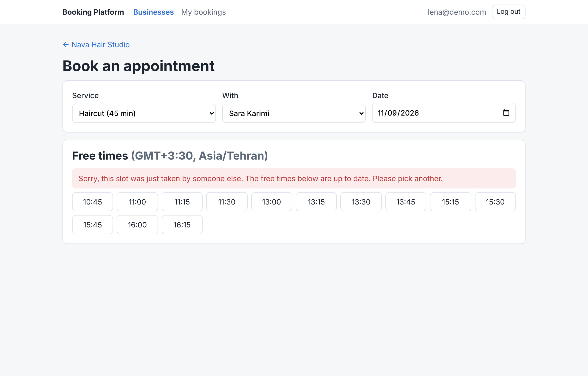
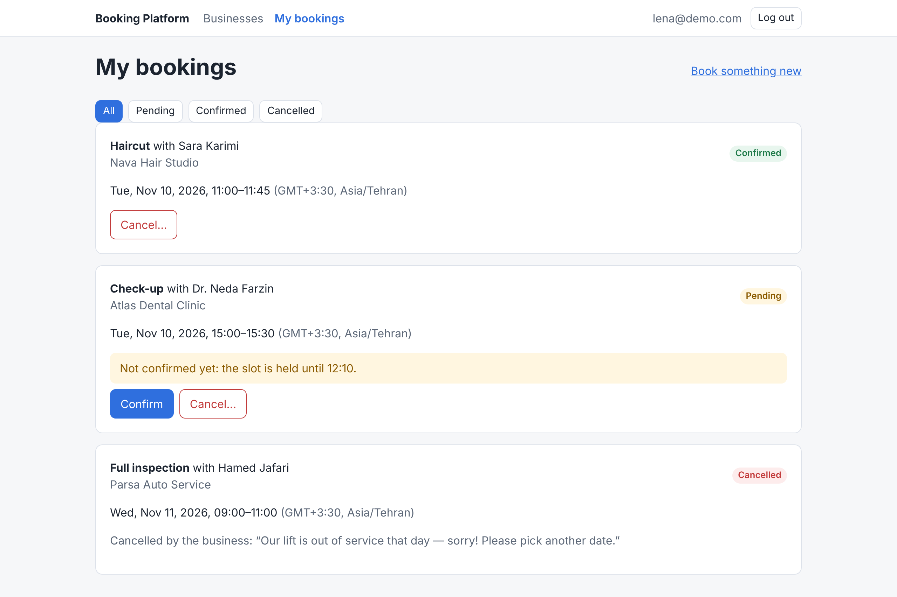
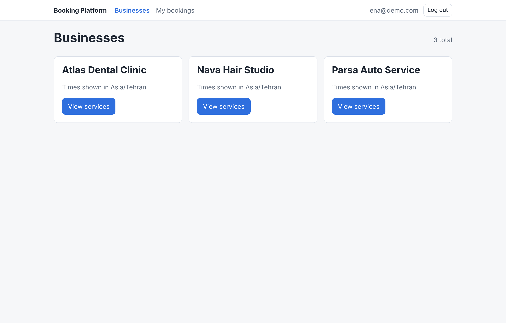
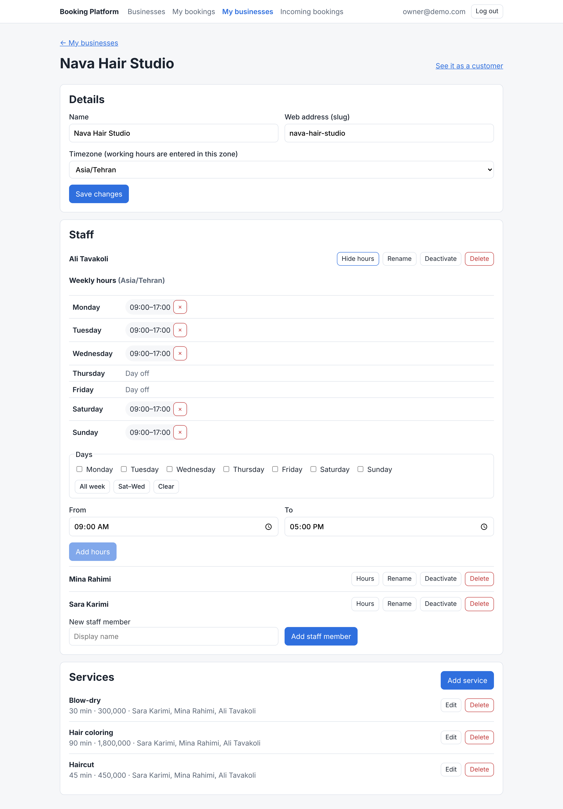
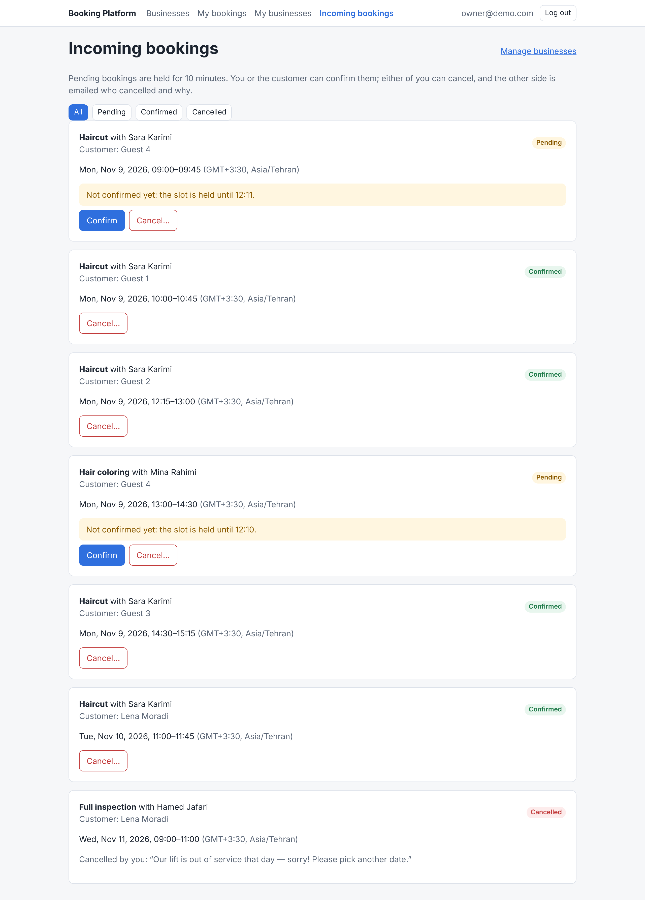

# Booking Platform

A multi-business appointment booking platform (think a small Calendly or salon-booking system): a **Django, Django REST Framework and PostgreSQL** backend with a **React + Redux Toolkit** frontend. Businesses define services, staff and weekly working hours; customers book open slots.

The focus of the project is **correctness under concurrency**: two customers clicking "Book" on the same slot at the same millisecond must never both succeed.


## Screenshots

<table>
<tr>
<td width="50%"><br><sub>Free times for a staff member and service, shown in the business's own timezone.</sub></td>
<td width="50%"><br><sub>Someone else booked the slot first: the API returns 409 and the free times refresh by themselves.</sub></td>
</tr>
<tr>
<td><br><sub>My bookings: confirm a pending hold, cancel with a reason, see who cancelled and why.</sub></td>
<td><br><sub>Customers browse businesses.</sub></td>
</tr>
<tr>
<td><br><sub>Owners manage staff, services and weekly hours (several days in one go; overlaps blocked by the database).</sub></td>
<td><br><sub>Owners confirm or cancel incoming bookings.</sub></td>
</tr>
</table>

## Highlights

**Double-booking is impossible at the database level.** Each booking's time is modelled as a half-open PostgreSQL range `tstzrange(start, end)`, and an exclusion constraint backed by a GiST index forbids two active bookings for the same staff member whose ranges overlap:

```python
ExclusionConstraint(
    name="booking_no_overlap_per_staff",
    expressions=[
        (TsTzRange("start", "end"), RangeOperators.OVERLAPS),
        ("staff", RangeOperators.EQUAL),
    ],
    condition=~Q(status="cancelled"),
)
```

This is stronger than the usual "check if the slot is free, then insert" approach, which has a race window between the check and the insert. Here PostgreSQL itself serialises conflicting inserts, so the rule holds no matter how many app servers or workers are running, and even for code that bypasses the service layer.

**Measured, not assumed.** `tests/test_concurrency.py` releases 20 threads (each with its own DB connection) through a barrier so they all try to book the same slot simultaneously:

| Implementation | Requests that succeeded |
|---|---|
| With the exclusion constraint | **1 of 20** (stable across repeated runs) |
| Constraint removed (mutation check) | 20 of 20 |

**Half-open ranges make back-to-back slots work naturally:** a 10:00–11:00 booking does not conflict with 11:00–12:00.

**Staff schedules get the same guarantee.** A second exclusion constraint, `working_hours_no_overlap` (`staff =`, `weekday =`, and a half-open range built from the shift's start and end times), means no write path can give someone overlapping shifts on the same weekday. That covers the single and bulk API, the admin and the shell. A 09:00–12:00 shift next to a 12:00–17:00 one is still allowed. The API turns a violation into the same friendly 400, and the bulk endpoint still names the clashing days. `tests/test_shift_concurrency.py` races 20 overlapping requests: with the constraint exactly 1 succeeds, and with it dropped several overlapping shifts got through, even though the serializer checks first. The migration that adds it first checks existing data, and stops with a list of any overlapping shifts instead of failing halfway.

**Timezone-correct.** All timestamps are stored in UTC; working hours are interpreted in each business's own IANA timezone.

**Rules live in one place.** All booking writes go through `apps/bookings/services.py`, which raises typed, client-actionable errors (`SlotUnavailable`, `OutsideWorkingHours`, `InvalidBookingRequest`) instead of leaking database errors.

## Data model

```
User (role: customer | staff | owner)
 └── Business (timezone)
      ├── Staff ── WorkingHours (weekly shifts)
      │         └── TimeOff     (no-overlap constraint)
      └── Service (duration, price) ←→ Staff  (who offers what)

Booking: customer, staff, service, [start, end), status, expires_at
         status: pending → confirmed → completed, or → cancelled
```

Unconfirmed bookings carry an `expires_at` hold (10 minutes) so abandoned checkouts do not block a slot forever; a partial index on pending bookings keeps the expiry sweep cheap.

## API

Interactive docs (Swagger UI) at `/api/docs/`, OpenAPI schema at `/api/schema/`. Auth is JWT: `POST /api/auth/login/` with `{email, password}`, then send `Authorization: Bearer <access>`.

| Endpoint | Who | Notes |
| --- | --- | --- |
| `POST /api/auth/register/`, `/login/`, `/refresh/`; `GET/PATCH /api/me/` | anyone / signed-in | self-registration as `customer` or `owner` only |
| `/api/businesses/`, `/staff/`, `/services/`, `/working-hours/` | read: any signed-in user; write: owners | writes are scoped to the owner's own data (others' objects 404) |
| `POST /api/working-hours/bulk/` | owners | the same hours on several weekdays (`{staff, weekdays, start_time, end_time}`), all-or-nothing; a 400 names the days that would overlap |
| `GET /api/availability/?staff=&service=&date=` | signed-in | free slots in 15-minute steps, in the business's local time |
| `POST /api/bookings/`, `GET /api/bookings/`, `POST /api/bookings/{id}/confirm/` and `/cancel/` | customer, or owner of the business | all writes go through `services.py` |

Booking errors are mapped in one place: a lost race for a slot is **409** (`slot_unavailable`); other rule violations (outside working hours, past start, expired hold) are **400** with a machine-readable `code`.

## Caching and background work

**Availability cache (Redis).** Free slots are cached per staff + service + date. Every key embeds a per-staff *version token*, so invalidating a staff member is a single write that orphans all their keys (any service, any date) without scanning. Model signals on bookings, shifts, time off, services (including who offers them), staff and the business timezone bump the token **on commit**: never before (a concurrent reader could re-cache old rows under the new version) and never on rollback. A 5-minute TTL bounds staleness if an invalidation is ever missed, and a Redis outage degrades to computing slots from PostgreSQL. The "not in the past" filter is applied on every read, so time passing can't make an entry stale. The tests fail if invalidation is disabled.

**Celery + Beat.**

| Task | Trigger | Notes |
| --- | --- | --- |
| `send_confirmation_email` | booking confirmed | queued with `transaction.on_commit` |
| `send_cancellation_email` | booking cancelled | says who cancelled and why; goes to the party who did *not* cancel |
| `send_due_reminders` → `send_reminder_email` | every 15 min | confirmed bookings starting within 24h |
| `release_expired_holds` | every minute | cancels lapsed pending holds via `services.expire_booking`, which re-checks under a row lock so it can't cancel a booking confirmed meanwhile |
| `resend_unsent_emails` | every 5 min | safety net: re-queues confirmation/cancellation emails still unsent 2+ min after the status change (e.g. broker was down at commit); skips past bookings and gives up after 24h |

Email tasks are idempotent: each *claims* its send with an atomic `UPDATE … WHERE <sent_at> IS NULL` (`confirmation_email_sent_at`, `cancellation_email_sent_at`, `reminder_sent_at`), so duplicate deliveries and concurrent workers send once; a failed send releases the claim and is retried with backoff. That same claim is what makes the sweep safe: re-queuing can never double-send.

## Frontend

`frontend/` is a React 19 single-page app (Vite, Redux Toolkit, RTK Query, React Router, plain CSS). Customers browse businesses, pick a service, staff member and date, see free slots **in the business's own timezone** and book. They then confirm or cancel from *My bookings*, where cancelled bookings show who cancelled and why. Owners create and edit their businesses, staff, weekly hours and services, and confirm or cancel incoming bookings.

How it connects to the backend:

- **One RTK Query API slice** with cache tags. Creating, confirming or cancelling a booking invalidates `Booking` and `Availability`, so lists and free slots refetch automatically. A **409 `slot_unavailable`** also invalidates `Availability`: the user sees "this slot was just taken" with the up-to-date free times, with no manual refetch.
- **JWT with silent refresh.** A custom base query attaches the access token. On a 401 it refreshes once and retries; concurrent 401s share a single refresh. It logs out only if the refresh token itself is rejected.
- **No CORS.** In development Vite proxies `/api` to Django, so the browser only ever talks to one origin.
- **Tested with Vitest, React Testing Library and MSW**: the refresh flow, the 409 handling, route protection, and the booking and owner pages.

[`frontend/ARCHITECTURE.md`](frontend/ARCHITECTURE.md) walks through the folder structure, the data flow (component → RTK Query hook → apiSlice → Django), the auth/refresh sequence and how cache tags work. It is written for someone learning React.

## Running locally

```bash
docker compose up --build
# App on http://localhost:5173 (Vite, proxies /api to Django)
# API on http://localhost:8000, Swagger on /api/docs/, admin on /admin
# `worker` and `beat` run the Celery tasks; dev emails print in their log:
#   docker compose logs -f worker
docker compose exec web python manage.py createsuperuser
```

Load demo data (three businesses with Sat–Wed staff hours, services, and bookings in every state):

```bash
docker compose exec web python manage.py seed_demo
# customer@demo.com / demo-pass-1234    owner@demo.com / demo-pass-1234
```

It is safe to re-run: the demo catalog is refreshed and the bookings at the demo businesses are replaced, so their dates stay relative to today. It only runs with `DEBUG` on, because the accounts use a published password.

Run the tests (PostgreSQL is required; SQLite cannot express range exclusion constraints):

```bash
docker compose exec web pytest --cov=apps
```

Or run everything CI runs in throwaway containers with `./check.sh`. For the backend that's lint, format, the migrations check, OpenAPI validation and pytest; for the frontend it's ESLint, Vitest and the Vite build.

## Tech stack

**Backend:** Django 5.2 · DRF · simplejwt · drf-spectacular · PostgreSQL 16 (`btree_gist`, range types) · Redis · Celery · pytest · Ruff

**Frontend:** React 19 · Vite · Redux Toolkit / RTK Query · React Router · Vitest · React Testing Library · MSW · ESLint

**Tooling:** Docker Compose · GitHub Actions (separate backend and frontend jobs)

## Roadmap

- [x] **Stage 1:** data model, overlap constraint, booking service, concurrency tests, Docker, CI
- [x] **Stage 2:** REST API (JWT auth, role-based permissions, availability endpoint), OpenAPI docs via drf-spectacular
- [x] **Stage 3:** Redis caching of available slots with invalidation; Celery for confirmation emails, reminders and releasing expired holds
- [x] **Stage 4:** React + Redux Toolkit frontend (RTK Query, JWT refresh, booking flow, owner pages)
- [ ] **Stage 5:** deployment, architecture diagram, query-performance benchmarks
